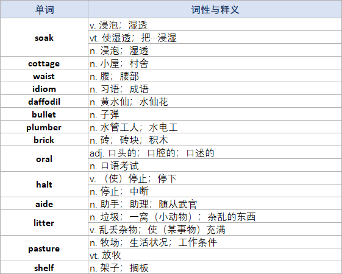

# English Word Extractor（图片英文单词提取 Skill）

一个 [WorkBuddy](https://www.workbuddy.cn) / Claude 风格的 Agent Skill：根据用户上传的图片，识别图中的英文单词，提取音标，标注词性（POS）及对应中文释义，并自动生成一个排版规范的三列表格 **Excel（.xlsx）文件**。

## 功能特性

- **图片识别**：支持教材截图、单词表、英语练习题、屏幕截图等以英文单词为主的图片
- **音标提取**：图片中已标注的音标原样照录；未标注的按标准词典补全 IPA 音标（默认英式，/…/ 包裹），无法确定时留空不编造
- **词性 + 中文释义**：按词典规范标注词性（n. / v. / vt. / vi. / adj. / adv. / prep. / conj. / pron. / num. / art. / interj.）
- **三列表格输出**：单词、音标、词性与释义（格式如 `n. 苹果`）
- **多词性合并单元格**：一个单词有多个词性时，单词列和音标列各自纵向合并；第二个及以后的词性释义依次放在第三列中、紧跟在第一个释义下方的单元格里
- **Excel 排版**：表头加粗底色、全表边框、自适应列宽、自动换行
- **去重与排序**：忽略大小写去重，按单词在图片中出现的顺序（从上到下、从左到右）排列
- **降级方案**：脚本执行失败时自动降级为 Markdown 表格输出

## 与 word-table-organizer 的分工

本 Skill 只负责**图片输入**。如果你手上是**文本清单**（直接粘贴一串单词，没有图片），请用配套的 [`word-table-organizer`](https://github.com/Cheering571/word-table-organizer)：

| 输入 | 该用哪个 Skill |
|---|---|
| 图片 / 截图 | **english-word-extractor**（本仓库） |
| 文本粘贴的单词清单 | [word-table-organizer](https://github.com/Cheering571/word-table-organizer) |
| 图片 + 文本清单 | 图片走本 Skill，文本部分交给 word-table-organizer，合并进同一张表 |

两个 Skill 共用同一份 `build_word_table.py`，产出的表格版式完全一致，可以在同一张表上交替追加。

## 输出示例

| 单词 | 音标 | 词性与释义 |
|------|------|-----------|
| book | /bʊk/ | n. 书；书本 |
|      |       | v. 预订；预约 |
| apple | /ˈæpl/ | n. 苹果 |

## 效果示例

### 输入图片

一张包含英文单词及其相关内容的截图（例如背单词 App 页面）：


### 输出表格

Skill 识别图中单词并生成三列表格 Excel 文件，单词列和音标列纵向合并，多词性释义依次堆叠：



## 目录结构

```
english-word-extractor/
├── assets/
│   └── examples/
│       ├── A.jpg             # 示例输入图片
│       └── B.png             # 示例输出表格
├── SKILL.md                  # Skill 定义（触发条件 + 执行流程）
└── scripts/
    └── build_word_table.py   # JSON → xlsx 表格生成脚本（依赖 openpyxl）
```

## 安装

### 方式一：让 Agent 直接安装（推荐）

将本仓库的 GitHub 链接发给你的 AI 助手（如 WorkBuddy），让它安装即可，例如：

```
帮我安装这个 Skill：https://github.com/Cheering571/english-word-extractor
```

Agent 会自动将仓库中的 Skill 文件安装到本机的 Skill 目录并生效。

### 方式二：手动安装（WorkBuddy）

1. 克隆或下载本仓库：

   ```bash
   git clone https://github.com/Cheering571/english-word-extractor.git
   ```

2. 将整个 `english-word-extractor` 文件夹复制到用户级 Skill 目录：

   ```
   Windows: C:\Users\<用户名>\.workbuddy\skills\english-word-extractor
   Linux/macOS: ~/.workbuddy/skills/english-word-extractor
   ```

3. 重启会话或开启新会话即可生效。

### 方式三：仅使用脚本

`scripts/build_word_table.py` 可脱离 Skill 独立使用：

```bash
pip install openpyxl
python scripts/build_word_table.py <input.json> <output.xlsx>
```

输入 JSON 格式：

```json
[
  {
    "word": "book",
    "phonetic": "/bʊk/",
    "entries": [
      {"pos": "n.", "meaning": "书；书本"},
      {"pos": "v.", "meaning": "预订；预约"}
    ]
  }
]
```

`phonetic` 为可选字段；无法确定的音标留空字符串，不要编造。

## 使用方法

安装后，在对话中上传图片并说：

- “识别图片里的英文单词”
- “帮我整理单词表”
- “extract the English words in this image”

Agent 会自动触发本 Skill：识别 → 提取音标 → 查证词性释义 → 生成 `单词表.xlsx` → 交付文件。

## 依赖

- Python 3.8+
- [openpyxl](https://pypi.org/project/openpyxl/) >= 3.0

## License

[MIT](./LICENSE)
